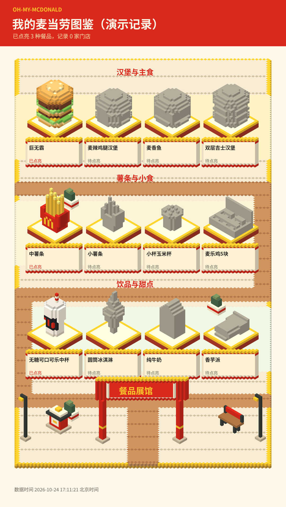
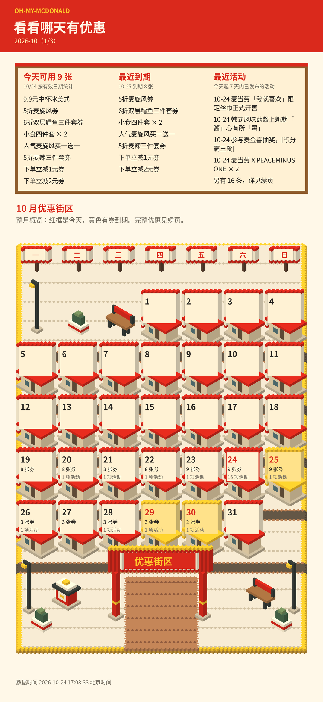
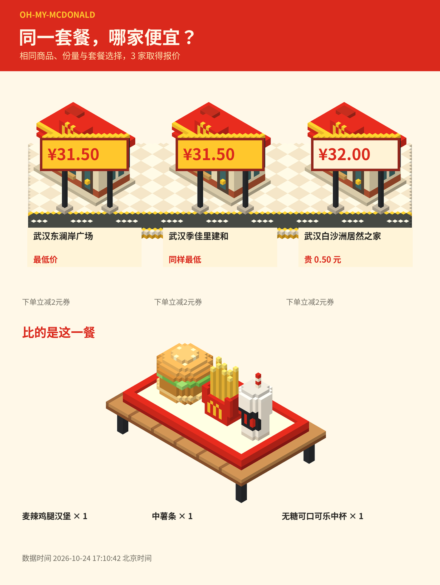
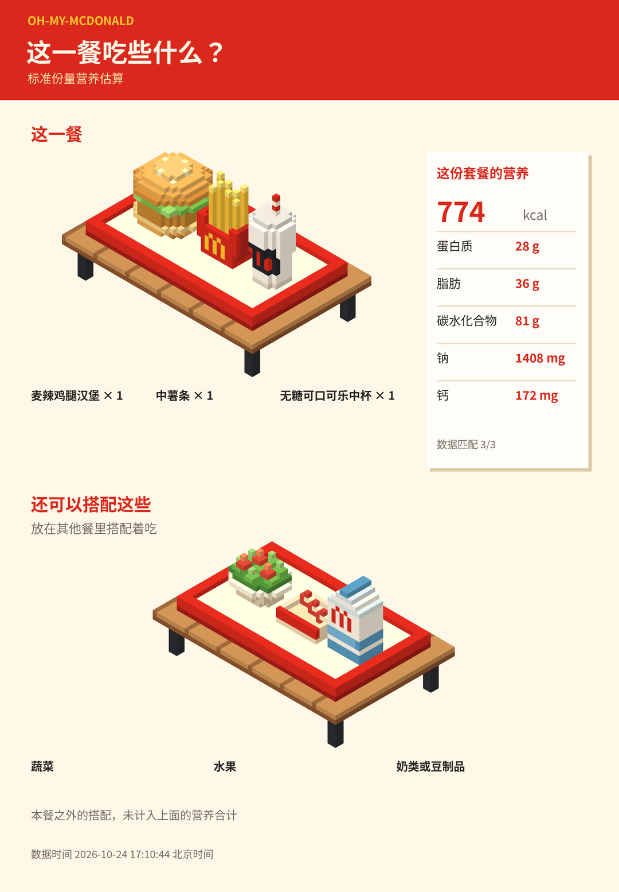

# Oh-My-McDonald

https://github.com/user-attachments/assets/e0bc2d36-26e1-42b6-9329-985fb6f0117f

[下载介绍视频](docs/videos/oh-my-mcdonald-intro.mp4)

**Oh-My-McDonald** 是一个基于麦当劳官方 MCP 的对话驱动 AI Skill。

你可以直接告诉 AI 今天想吃什么、预算多少、有什么不想吃的，也可以查询门店价格、优惠券、活动和餐品营养。吃过的餐品和去过的门店经过确认后，还能保存成自己的探索记录。

项目使用 Python 本地脚本处理数据和生成图片，将查询结果整理成四种体素风格的 PNG 场景。不需要网页界面，也不依赖图片生成 API。

## 场景预览

<table>
  <tr>
    <td align="center" width="50%">
      
      <br>
      <strong>餐品图鉴</strong>
      <br>
      吃过并确认记录的餐品会点亮展台，尚未记录的餐品保持灰色。
    </td>
    <td align="center" width="50%">
      
      <br>
      <strong>优惠日历</strong>
      <br>
      查看今天能用的券、近期活动，以及快到期的优惠。
    </td>
  </tr>
  <tr>
    <td align="center" width="50%">
      
      <br>
      <strong>门店比价</strong>
      <br>
      同一商品、同一规格，看看选中的几家门店分别卖多少钱。
    </td>
    <td align="center" width="50%">
      
      <br>
      <strong>营养餐桌</strong>
      <br>
      将餐品放在同一餐盘里，旁边展示营养数据和额外搭配参考。
    </td>
  </tr>
</table>

> 餐品图鉴使用演示记录，图片中保留了演示标识。其余预览基于 2026 年 10 月 24 日的真实 MCP 查询快照，并非实时数据。发布图片仅展示必要的餐品名称、门店名称、价格、营养数据和优惠标题。

## 项目介绍

Oh-My-McDonald 提供一组可以由 AI 调用的本地工具。

项目通过麦当劳官方 MCP 获取餐品、门店、价格、优惠和营养信息，由 AI 理解用户的自然语言需求，再交给 Python 脚本完成查询辅助、数据处理、记录保存和图片渲染。

整个使用过程以对话为主。

例如，你可以问：

- 今天想吃麦当劳，预算 35 元，不要辣的，有什么推荐？
- 帮我从符合条件的餐品里随机挑一个。
- 这份套餐在附近三家门店分别多少钱？
- 我现在有哪些可用券？最近有没有活动？
- 这顿饭的能量和蛋白质分别是多少？
- 我刚刚吃过这个汉堡，帮我记下来。
- 把我吃过的餐品生成一张图鉴。

项目主要解决三个问题：

1. 将分散的餐品、门店和优惠信息放到同一次对话中查询。
2. 让用户可以按照自己的实际需求选择餐品，并保存经过确认的探索记录。
3. 将原本以文字和数字呈现的信息转换成更直观、方便分享的图片。

## 适合谁使用

- 经常吃麦当劳，想了解不同餐品和优惠信息的人。
- 想根据预算、口味和排除条件决定今天吃什么的人。
- 想比较不同门店同款商品价格的人。
- 想记录自己吃过哪些餐品、去过哪些门店的人。
- 对 MCP、AI Skill、本地图像生成感兴趣的开发者。

## 功能

### 1. 今天吃什么

通过自然语言描述自己的需求，由 AI 查询真实餐品并筛选候选项。

支持：

- 设置用餐预算。
- 排除不想吃的餐品或类型。
- 从符合条件的真实候选中随机选择。
- 单次抽选最多使用 6 个候选餐品组合。

候选餐品来自 MCP 查询结果，不由 AI 虚构。

### 2. 门店价格比较

查询指定门店的餐品价格，并比较同一商品、同一规格的到店价。

支持：

- 查询附近门店。
- 查看指定商品的详细信息。
- 对最多 3 家选定门店进行价格比较。
- 按当前测试方案计算价格。
- 将比较结果生成体素街道图片。

图片中，不同门店的门口会挂出对应价格，方便看出差异。

价格对应查询时选中的门店、商品规格和优惠方案。

### 3. 优惠券和活动日历

通过 MCP 查询优惠券包和已发布的活动信息。

支持：

- 查询用户优惠券信息。
- 查看活动日历。
- 按日期统计可用券和活动数量。
- 标出优惠券到期日期。
- 展示近期到期的优惠券和已发布的活动。

生成的优惠日历采用体素街区风格。

首页重点展示今日有效券、最近到期的优惠券和近期活动；完整明细放在续页中，避免所有信息挤在同一张图片里。

日历按本人券包的有效日期统计。券的适用时段、门店和商品条件按 MCP 返回的信息处理。

### 4. 餐品营养计算

根据实际选择的餐品计算营养数据。

支持展示：

- 能量
- 蛋白质
- 脂肪
- 碳水化合物
- 钠
- 钙

营养计算以准确匹配的餐品为基础，不使用名称相似但无法确认的商品替代。

如果存在缺失的营养字段，会单独列出，不将缺失值当作零。

生成的营养图片采用体素餐桌场景：

- 本餐食物放在同一餐盘中。
- 营养数据以小票形式展示。
- 蔬菜、水果和奶类等补充搭配单独摆放。

蔬菜、水果和奶类作为餐外搭配参考，单独展示；本餐数值只统计餐盘内的食物。

### 5. 餐品图鉴和探店记录

记录实际吃过的餐品和去过的门店。

餐品图鉴使用分区体素展馆呈现，包含转弯步道和餐品展台。

- 已吃过且确认保存的餐品会点亮。
- 尚未确认记录的餐品保持灰色。
- 可以统计已点亮的餐品数量。
- 可以记录和统计探店数量。
- 演示记录与真实记录明确区分。

订单信息不会直接成为已完成的食用记录。

只有用户确认实际食用后，才保存记录并点亮对应餐品。

## 本地体素渲染

项目内置 Python 体素渲染实现，能够将查询结果生成为 PNG 图片。

目前包含 **43 个粗体素模型**，使用 Python 构建整数几何，按 **8 px/格** 的规则进行渲染。

四种主要场景分别是：

| 场景 | 展示内容 |
| --- | --- |
| 餐品图鉴 | 分区展馆、转弯步道、餐品展台和点亮状态 |
| 优惠日历 | 整月优惠街区、今日信息、到期提醒和活动告示栏 |
| 门店比价 | 体素街道、门店建筑和对应的价格标牌 |
| 营养餐桌 | 套餐餐盘、营养小票和餐外搭配参考 |

渲染由本地 Python 脚本完成，不需要调用 OpenAI API 或其他图片生成 API。

街道、展馆和餐桌是数据可视化场景，门店的排列用于比较报价。

## 安装与运行

### 环境要求

- Python 3.11 或更高版本
- 能够正常使用的 Python 虚拟环境
- 支持中文的字体，推荐 Noto Sans CJK
- 使用实时查询功能时，需要麦当劳官方 MCP 的访问凭据

项目的主要 Python 依赖包括：

| 依赖 | 版本要求 |
| --- | --- |
| Pillow | `>=10,<13` |
| NumPy | `>=1.24,<3` |

依赖统一记录在 `requirements.txt` 中。

### 1. 克隆仓库

```bash
git clone https://github.com/xiaozhangup/Oh-My-McDonald.git
cd Oh-My-McDonald
```

### 2. 创建虚拟环境

```bash
python -m venv .venv
source .venv/bin/activate
```

以上激活命令适用于 Linux 和 macOS。

Windows 用户可以使用：

```powershell
.venv\Scripts\Activate.ps1
```

### 3. 安装依赖

```bash
python -m pip install -r requirements.txt
```

### 4. 配置中文字体

推荐安装 Noto Sans CJK。

如果需要使用指定字体，可以通过 `OMM_FONT` 环境变量提供本机字体路径：

```bash
export OMM_FONT="/path/to/your/font.ttf"
```

将路径替换为本机实际存在的中文字体文件。

### 5. 查看命令帮助

```bash
python oh-my-mcdonald/scripts/oh_my_mcdonald.py --help
```

该入口提供项目本地辅助脚本的命令说明。

## MCP 接入

项目通过麦当劳官方 MCP 获取实际业务数据。

### 1. 获取访问凭据

访问 [麦当劳 MCP 控制台](https://open.mcd.cn/mcp)

按照官方页面的说明获取 MCP Token。

Token 通过本机环境变量或显式指定的 Codex 配置读取。

### 2. 配置 Token

可以通过当前进程的环境变量提供 Token：

```bash
export MCD_MCP_TOKEN="YOUR_MCD_MCP_TOKEN"
```

也可以在执行命令时，通过 `--codex-config` 显式指定本机 Codex 配置文件：

```bash
python oh-my-mcdonald/scripts/oh_my_mcdonald.py \
  --codex-config /本机/config.toml stores --city 武汉 --keyword 东澜岸
```

该方式读取本机配置中已有的 `mcd-mcp` 配置。

两种方式均用于本机凭据读取，不需要将实际 Token 放进项目文件。

### 3. MCP 工具

项目的实际 MCP 集成涉及以下工具：

| 工具 | 用途 |
| --- | --- |
| `query-nearby-stores` | 查询附近门店 |
| `query-meals` | 查询餐品 |
| `query-meal-detail` | 查询餐品详情 |
| `query-store-coupons` | 查询门店优惠信息 |
| `query-my-coupons` | 查询用户券包 |
| `calculate-price` | 计算指定商品的价格 |
| `campaign-calendar` | 查询活动日历 |
| `list-nutrition-foods` | 获取营养计算所需的餐品数据 |
| `order-list` | 查询订单记录 |

这些工具用于获取真实业务数据，本地 Python 脚本负责辅助处理和可视化。

完整接入说明和调用流程见：

[MCP_INTEGRATION.md](MCP_INTEGRATION.md)

## 在 AI 客户端中使用

项目提供 AI Skill 描述文件：

```text
oh-my-mcdonald/SKILL.md
```

可以让支持 Skill 的 AI 客户端读取该文件，了解项目的能力、使用流程与限制。

具体的脚本命令和参数说明见：

[oh-my-mcdonald/references/commands.md](oh-my-mcdonald/references/commands.md)

一个典型的使用流程是：

1. 用户用自然语言提出需求。
2. AI 根据需求选择对应的 MCP 查询工具。
3. AI 将查询结果与用户的预算、排除条件等进行匹配。
4. 按需调用本地 Python 脚本完成辅助处理。
5. 需要生成图片时，由本地渲染器输出 PNG。
6. 涉及食用或探店记录时，等待用户确认后再保存。

客户端需要具备相应的 MCP 接入和本地命令执行能力。

本项目不要求使用特定的 AI 模型，也不依赖 OpenAI API。

## 命令行示例

以下命令均在项目根目录执行。

### 查询武汉的门店

查询名称或位置中与“东澜岸”相关的门店：

```bash
python oh-my-mcdonald/scripts/oh_my_mcdonald.py stores \
  --city 武汉 \
  --keyword 东澜岸
```

### 查询指定餐品详情

```bash
python oh-my-mcdonald/scripts/oh_my_mcdonald.py detail \
  --store 1960151 \
  --code 9900005456
```

其中：

- `--store` 指定门店 ID。
- `--code` 指定餐品代码。

示例 ID 用于演示参数格式，实际查询时应使用 MCP 返回的有效数据。

### 查询购物篮报价

```bash
python oh-my-mcdonald/scripts/oh_my_mcdonald.py quote \
  --store 1960151 \
  --basket examples/basket.json
```

购物篮内容由 JSON 文件提供，报价根据指定门店和当前测试方案计算。

### 离线查看体素模型

不连接 MCP，也可以查看本地模型：

```bash
python oh-my-mcdonald/scripts/oh_my_mcdonald.py \
  --out output models
```

输出目录为 `output`。

更多命令、参数和使用方式请查看：

[命令参考](oh-my-mcdonald/references/commands.md)

## 测试与验证

项目包含基于 Python `unittest` 的自动化测试。

在项目根目录执行：

```bash
python -m unittest discover -s tests -v
```

现有测试共 **51 项，均已通过**。

自动化测试使用合成数据，验证业务处理、输出和渲染逻辑。

真实 MCP 查询和验证结果单独记录在：

[docs/VALIDATION.md](docs/VALIDATION.md)

其中包括真实数据查询的验证情况以及相关限制。

预览图片所使用的真实 MCP 快照日期为 **2026 年 10 月 24 日**，后续查询结果可能发生变化。

## 实现边界

当前实现范围如下：

**价格比较**

只比较选定门店、同一商品和同一规格在当前测试方案下的报价。最多比较 3 家门店，不推断其他门店的价格。

**优惠信息**

按本人券包的有效日期统计券数，并展示已发布活动。适用时段、门店与商品条件另行处理。

**营养计算**

仅计算精确匹配的餐品。缺失字段单独说明，不使用其他商品的营养数据代替。额外展示的蔬菜、水果和奶类不计入本餐。

**食用记录**

订单查询结果先作为待确认信息。用户确认实际吃过后，才保存食用记录并点亮图鉴。探店记录同样需要用户确认。

**自动化范围**

项目不支持自动下单、付款或领取优惠券，也不提供云端同步和后台轮询。

**图片与地图**

体素场景由本地程序生成，仅用于信息展示。门店比价街道是示意场景，不包含真实道路或地理位置关系。

## 项目结构

主要文件和目录如下：

```text
Oh-My-McDonald/
├── oh-my-mcdonald/
│   ├── SKILL.md
│   ├── scripts/
│   │   └── oh_my_mcdonald.py
│   └── references/
│       └── commands.md
├── docs/
│   ├── images/
│   │   ├── overview.png
│   │   ├── gallery.png
│   │   ├── calendar.png
│   │   ├── compare.png
│   │   └── nutrition.png
│   └── VALIDATION.md
├── examples/
│   └── basket.json
├── tests/
├── requirements.txt
├── MCP_INTEGRATION.md
├── CONTEST_DECLARATION.md
└── LICENSE
```

其中：

- `SKILL.md` 描述 AI 客户端如何使用项目。
- `scripts/` 包含本地辅助脚本和渲染实现。
- `references/` 提供命令使用参考。
- `docs/images/` 存放场景预览图片。
- `docs/VALIDATION.md` 记录验证结果。
- `MCP_INTEGRATION.md` 介绍 MCP 接入和实际调用流程。
- `CONTEST_DECLARATION.md` 保留比赛官方声明原文。

## 开源与贡献

项目代码托管于 GitHub：

https://github.com/xiaozhangup/Oh-My-McDonald

欢迎通过 Issues 反馈问题、提出建议，也欢迎通过 Pull Requests 参与改进。

## 许可证

本项目基于 [MIT License](LICENSE) 开源。

详细条款请查看仓库中的 `LICENSE` 文件。
